# SupermarketsStores
中小超市仓库管理 
亮点：DeepSeek智能报表、 ECharts库存分析、库存与保质期预警、二维码与库位可视化、仓库作业闭环；
亮点：员工、管理员；

所有源码均本人开发，项目是前后端分离的，所有的项目都具备了完整的业务逻辑，不仅仅局限于基础的增删改查（CRUD）操作，系统亮点众多。

本文注重于计算机毕业设计选题指导，列出题目均有源码， 大家可以去【公众号】(毕业终点站)获取或者加我【qq】(2112698948)提意见(别忘记Star哟)。备注：git

声明：仅用于学习使用，请勿用于任何商业行为！

1.系统非商用，非开源，非无偿。

2.由本人开发，如需源码，请联系以下方式，qq:2112698948。

3.项目有很多，并未全部上传，如果未找到想要的，可直接咨询。

# 中小超市仓库管理系统

面向中小超市与门店的仓库管理系统，覆盖账号权限、库存记录与流水、盘点移位、入库收货、出库拣货、商品与库位基础资料，以及库存分析与 AI 智能报表。

## 一、技术栈

- **架构**：B/S、MVC、前后端分离；管理员与员工角色，菜单及按钮权限配置
- **后端**：Java、Spring Boot 3、Spring MVC、MyBatis-Plus、MySQL 8、JWT、Lombok、Apache POI、DeepSeek API
- **前端**：Vue 3、Vite、Element Plus、Vue Router、Pinia、Axios、ECharts、Sass、二维码生成与识别
- **环境**：Windows、IDEA、JDK 17、Maven、MySQL 8、Node.js

## 二、系统亮点

1. **DeepSeek 智能报表**：用自然语言描述统计需求，由后端生成数据库查询，支持表格、柱状图、折线图和饼图展示，并保留历史会话。
2. **ECharts 库存分析**：近 7 天与近 12 个月出入库趋势、仓库库存占比、商品分类分布、周转分析和进销存汇总。
3. **库存与保质期预警**：按仓库和商品设置库存上下限，区分库存不足、过多与正常状态；结合生产日期与保质期展示临期和过期商品。
4. **二维码与库位可视化**：商品二维码可生成、保存，并通过图片识别填入 SKU，结合仓库 2D 库位展示。
5. **从入库到盘点的作业全流程**：入库审核、收货上架、出库分配、拣货、盘点和移位相互关联，单据、明细、库存与流水可追溯商品批次。

## 三、用户角色

- **管理员**：账号与权限配置、库内管理（库存记录/流水/盘点/移位）、入库管理、出库管理、基础资料管理、报表统计
- **员工**：可访问的菜单与按钮由管理员按角色授权配置（登录页可选「员工」角色）

## 四、运行截图

> 源文档未提供独立的系统总览图，以下按登录入口与后台各功能模块分区展示。

### 4.1 登录入口

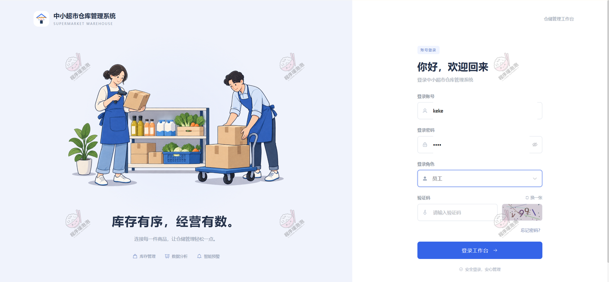

**登录页**：左右分栏，左侧为仓储插画与标语「库存有序，经营有数」，右侧为账号登录，可选择登录角色并填写验证码。

### 4.2 账号与权限

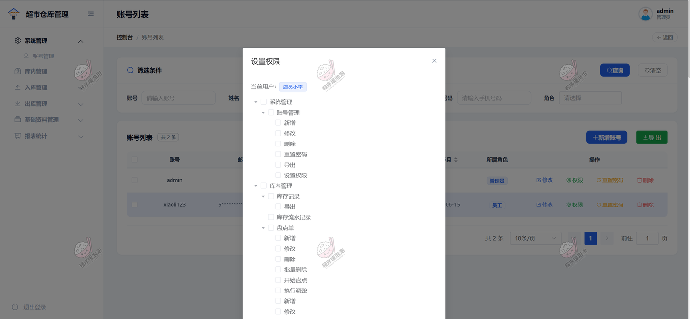

**账号列表与权限设置**：账号 admin（管理员）与员工账号并列展示；弹窗内按「系统管理 / 库内管理」逐项勾选新增、修改、删除、导出、设置权限等按钮权限，实现菜单与操作级授权。

### 4.3 库内管理

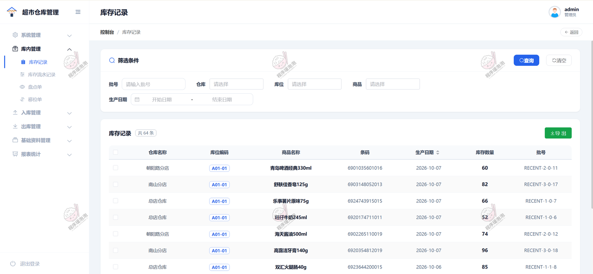

**库存记录**：按仓库、库位、商品、批号与生产日期筛选，列出各仓各库位的商品条码、生产日期、库存数量与批号（共 64 条）。

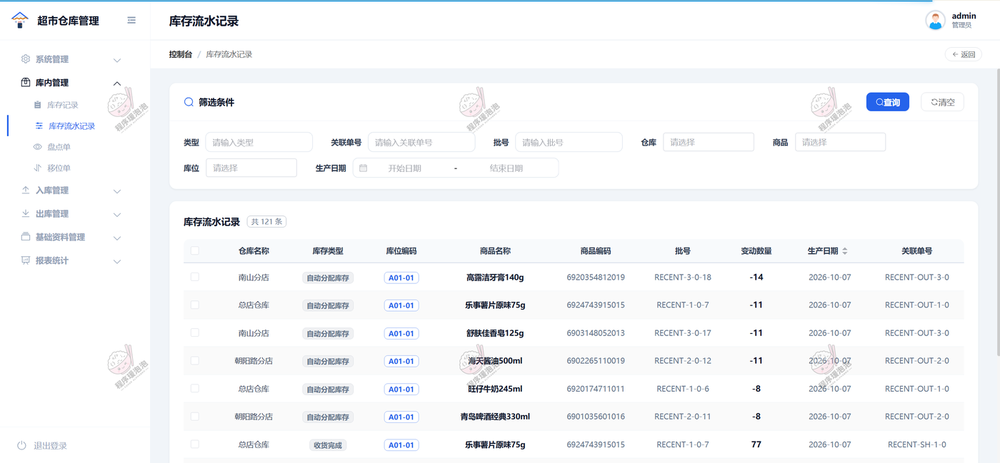

**库存流水记录**：记录每次库存变动的类型（自动分配库存、收货完成等）、变动数量与关联单号，正负数区分出入库（共 121 条）。

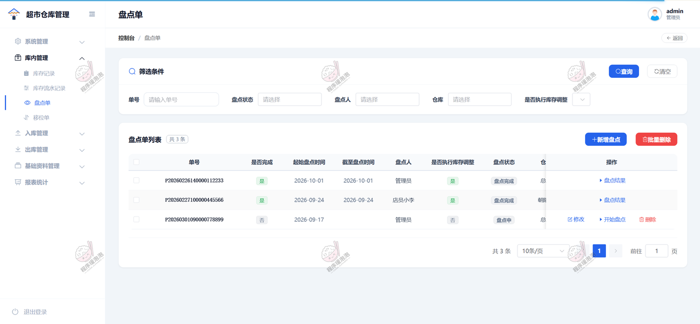

**盘点单**：列表含单号、是否完成、起止盘点时间、盘点人、是否执行库存调整与盘点状态，支持新增盘点、开始盘点与查看盘点结果。

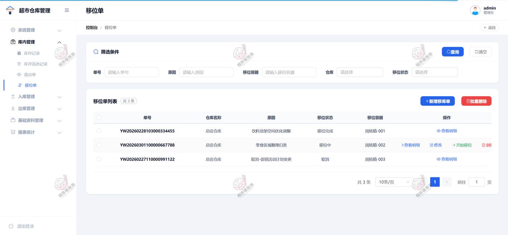

**移位单**：记录移位原因（如货架空间优化、零食区域整理归位）、移位状态与周转箱，支持新增、修改、开始移位与查看明细。

### 4.4 入库管理

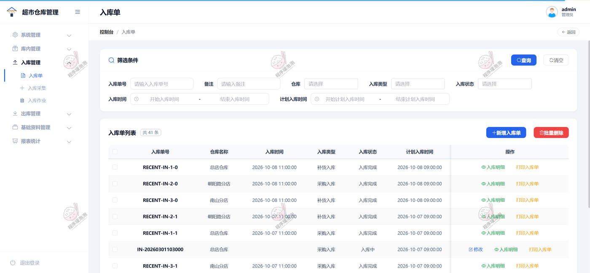

**入库单**：按入库单号、仓库、类型、状态与时间筛选，列表含入库类型（补货入库/采购入库）、入库状态与计划入库时间（共 41 条）。

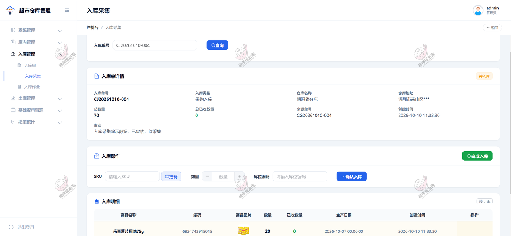

**入库采集**：顶部显示入库单总量与已收数量，中间按 SKU 扫码或手输数量与库位编码逐条确认入库，底部为待收商品明细。

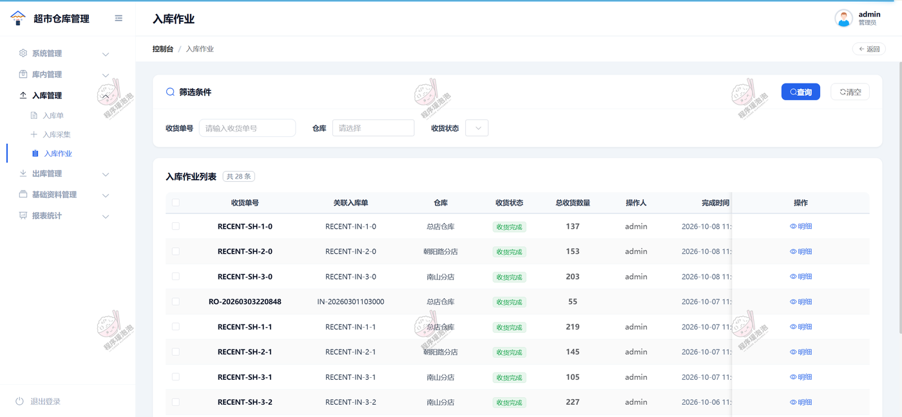

**入库作业**：收货单列表关联入库单，展示收货状态、总收货数量、操作人与完成时间（共 28 条）。

### 4.5 出库管理

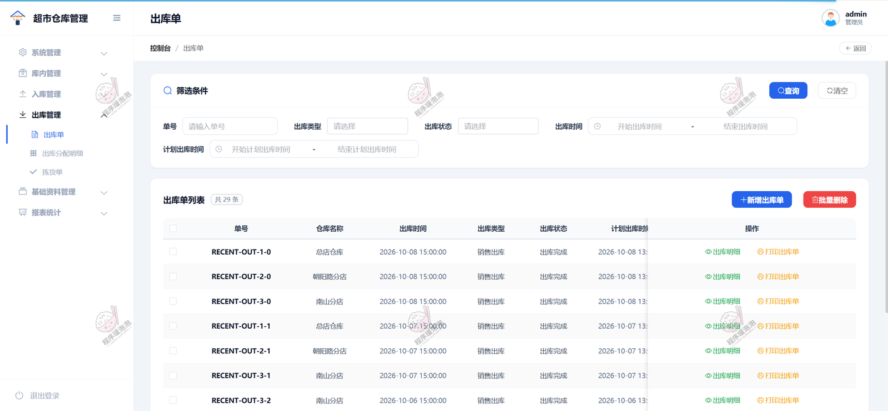

**出库单**：销售出库单列表，含仓库、出库时间、出库类型、出库状态与计划出库时间（共 29 条）。

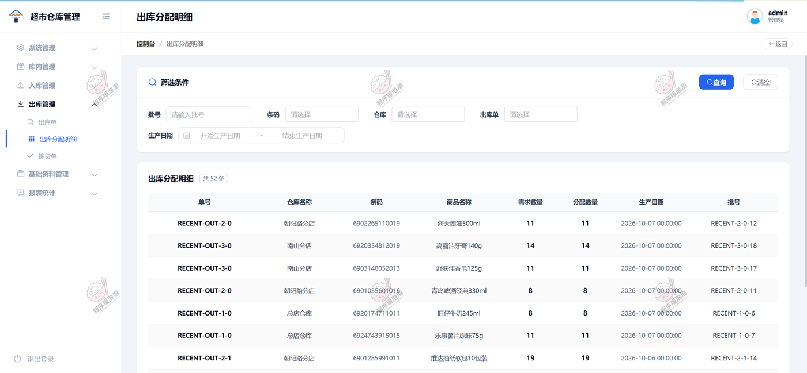

**出库分配明细**：按出库单列出每个商品的条码、需求数量、分配数量、生产日期与批号，需求与分配数量一致（共 52 条）。

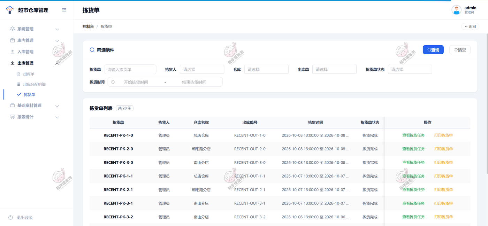

**拣货单**：拣货单关联出库单，记录拣货人、仓库、拣货时间段与拣货状态，支持查看拣货任务与打印拣货单。

### 4.6 基础资料管理

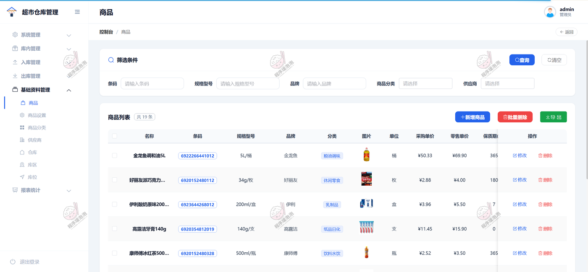

**商品**：商品档案含条码、规格型号、品牌、分类、单位、采购单价、零售单价与保质期天数（共 19 条）。

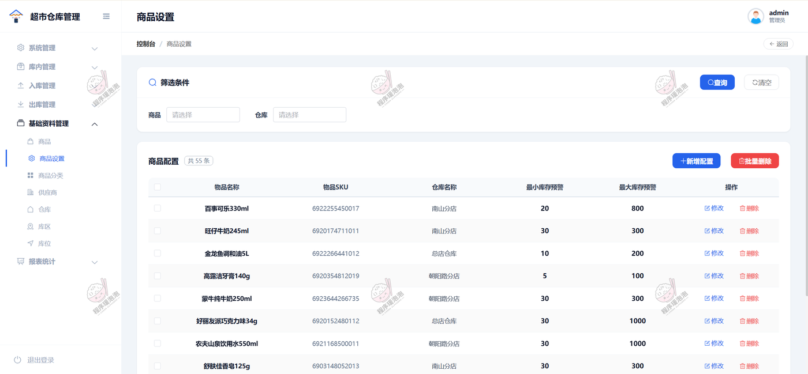

**商品设置**：按商品与仓库配置最小/最大库存预警值，用于库存不足与库存过多的判定（共 55 条）。

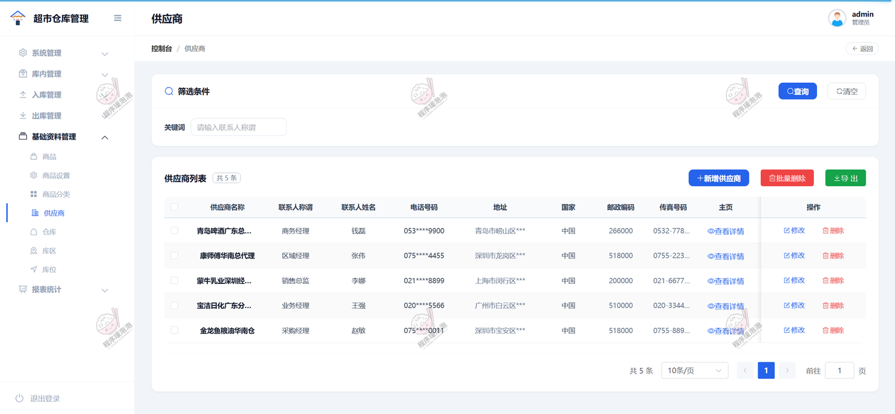

**供应商**：供应商档案含联系人称谓、姓名、电话、地址、国家、邮政编码与传真号码，支持新增、修改与导出（共 5 条）。

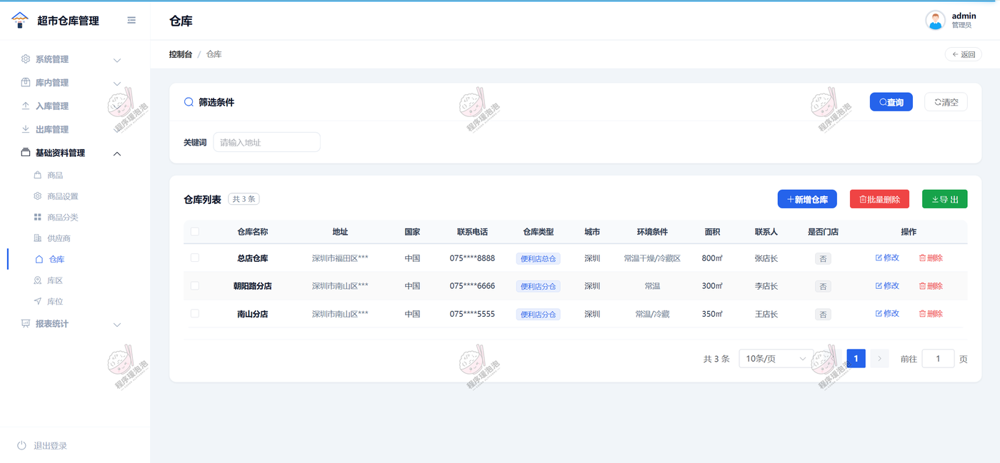

**仓库**：仓库档案含地址、联系电话、仓库类型、城市、环境条件（常温/冷藏）与面积，共 3 个仓库（总店仓库、朝阳路分店、南山分店）。

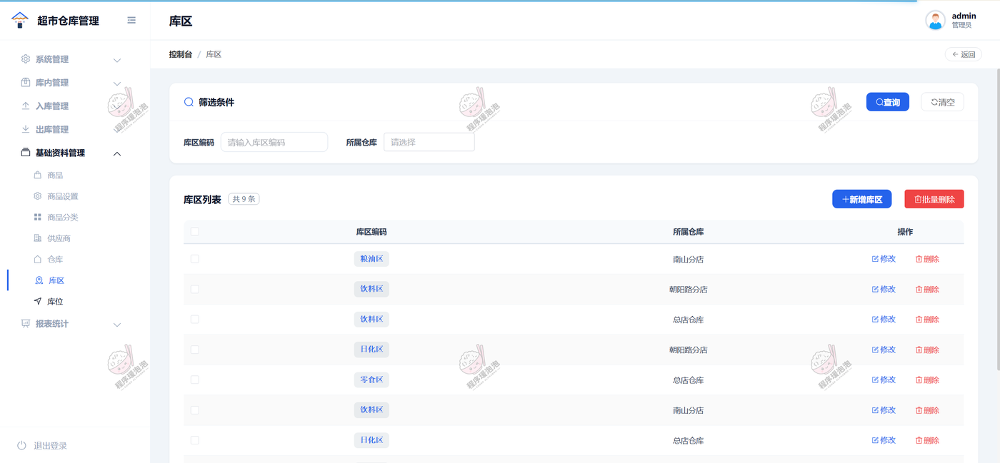

**库区**：按仓库维护库区编码（粮油区、饮料区、日化区、零食区等），并显示所属仓库（共 9 条）。

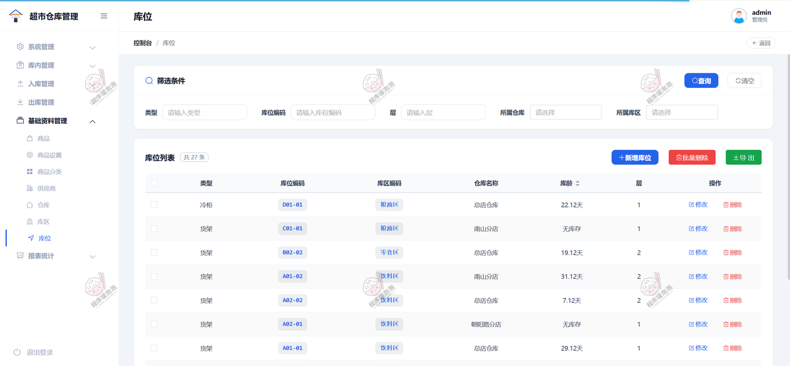

**库位**：库位含类型（冷柜/货架）、库位编码、所属库区与仓库、库龄与层，无商品的库位显示「无库存」（共 27 条）。

### 4.7 报表统计

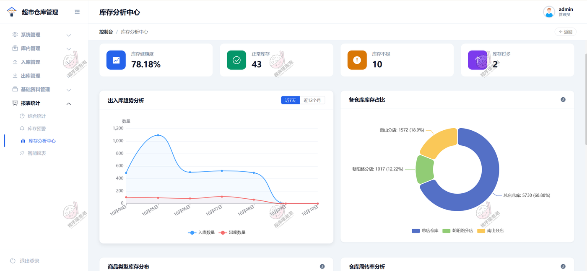

**库存分析中心**：顶部为库存健康度 78.18%、正常库存 43、库存不足 10、库存过多 2，配出入库趋势折线（近 7 天 / 近 12 个月）与各仓库库存占比环图（总店仓库 5730、南山分店 1572、朝阳路分店 1017）。

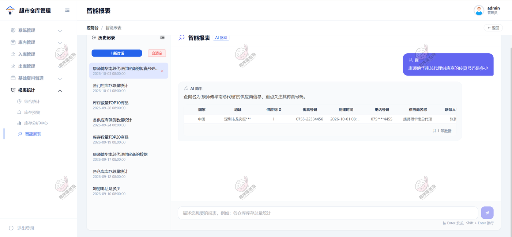

**智能报表**：左侧为历史提问记录，右侧用自然语言提问（如「康师傅华南总代理供应商的传真号码是多少」），以表格返回查询结果。

## 五、说明

文档展示 20 张截图，需要了解更多，请联系我。
